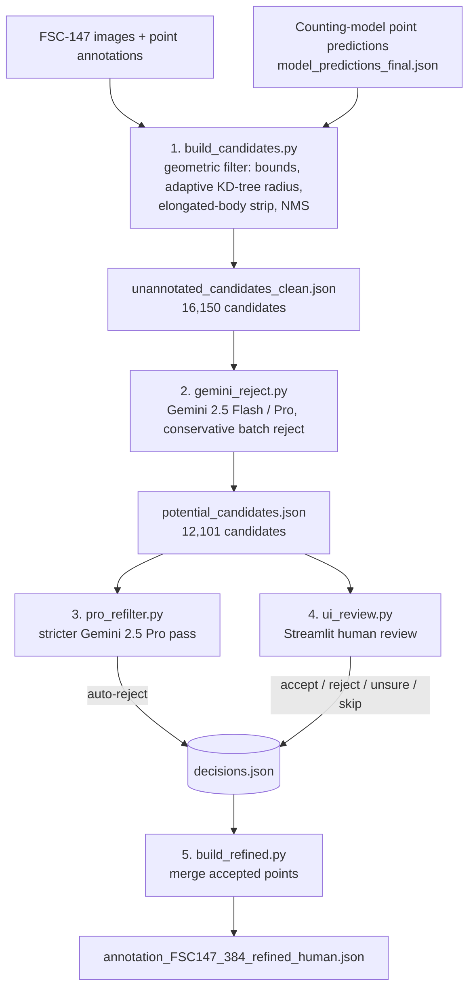

# Refining FSC-147 Annotations with Vision-Language Models

FSC-147 is the standard benchmark for class-agnostic object counting, and its point annotations are incomplete. Objects at the image border, in shadow, or very small are often left unlabelled, so a counting model that finds them is scored as wrong. The project's BTP paper (in preparation) calls this the *Ground Truth Paradox*.

This repository holds the ground-truth refinement pipeline from my B.Tech project. It works in four steps:

1. Take the counting model's high-recall point predictions.
2. Drop every prediction that matches an existing annotation, using a geometric filter.
3. Ask **Gemini 2.5 (Flash / Pro) on Vertex AI** to reject candidates that are clearly wrong, using the image and exemplar crops.
4. Send the remaining candidates through a **Streamlit human-review UI**. Accepted points are merged into a refined annotation file.

> The counting model is **CountGD-Patch**, a memory-efficient patch-based version of CountGD. Its code is in **[yashsinha1702/countgd-patch](https://github.com/yashsinha1702/countgd-patch)**. This repo starts from that model's predictions and covers the dataset-refinement part of the project.

---

## Key results

### Pipeline outputs shipped in this repo

Every number below comes from the files in `outputs/` and `logs/`.

| Stage | In | Out | Source |
|---|---|---|---|
| Counting-model predictions | 6,146 images | **372,176** predicted points | `outputs/model_predictions_final.json` |
| Geometric filter (`build_candidates.py`) | 372,176 points | **16,150** candidates in **3,266** images | `logs/build_candidates.log` |
| Gemini conservative reject (`gemini_reject.py`) | 16,150 candidates | **12,101** kept, 4,049 rejected (25.1 %), in 2,530 images | `logs/reject_*.log`, `outputs/review_pipeline/gemini_filter_log.json` |
| Gemini 2.5 Pro stricter re-filter (`pro_refilter.py`) | 6,094 not-yet-reviewed candidates (5,971 from the Flash stage) | 2,215 kept, **3,879 auto-rejected (63.7 %)** | `logs/pro_refilter.log` |
| Final decisions (`ui_review.py` + Pro re-filter) | 5,462 decided candidates | **566 accept**, 4,896 reject | `outputs/review_pipeline/decisions.json` |
| Merge (`build_refined.py`) | 566 accepted points | **+566 points across 161 images** | `outputs/review_pipeline/merge_summary.json` |

The rows break down as follows:

- **Geometric filter.** Of the 372,176 predictions:
  - 324,995 lie within an adaptive radius of an existing annotation.
  - 24,927 are out of bounds.
  - 3,954 fall inside the body of an elongated, already-annotated object.
  - 2,150 are near-duplicates removed by NMS.
  - 16,150 survive.
- **Gemini models.** Gemini 2.5 Flash handled the first 1,855 images: a 30-image pilot, then 1,825 more. It rejected 1,850 of 8,957 candidates (20.7 %). The run then resumed on the remaining 1,411 images with Gemini 2.5 Pro (`--pro`), which rejected 2,199 of 7,193 candidates (30.6 %).
- **Human review.** 5,462 of the 12,101 surviving candidates have a final decision, and the rest were never reviewed. The Pro re-filter flagged 3,879 candidates as reject, and 213 of those ended with a human **accept**. The VLM judge is a useful filter, but it is not ground truth.
- **Impact.** The 161 images that changed go from 16,730 to 17,296 annotated points (+3.4 %). The largest single correction is `1768.jpg`: 433 → 462 points. The median is +2 points per modified image.

### CountGD-Patch: reported in the BTP paper (draft, not yet public)

| Model (FSC-147) | MAE ↓ | RMSE ↓ | Peak memory |
|---|---|---|---|
| Original CountGD (baseline) | 7.10 | 24.56 | > 12 GB, out of memory on an 11 GB RTX 2080 Ti |
| CountGD-Patch, 2-scale | 11.39 | – | 5.2 GB |
| CountGD-Patch, 4-scale | 7.71 | 28.10 | 10.2 GB |
| **CountGD-Patch, 4-scale + top-down FPN** | **7.58** | **26.64** | runs on an RTX 2080 Ti |

The paper also reports an earlier, fully automated refinement run: 6,088 images processed, 5,199 images updated, and 11,156 of 29,142 candidates validated by the VLM judge (38.2 %). That run used a different setup: text-prompted zero-shot CountGD-Patch, a single VLM verification prompt and no human review. Its numbers therefore do not match the human-in-the-loop outputs above.

---

## Pipeline overview



1. **Geometric candidate filter** (`scripts/build_candidates.py`, no API calls). For each image the script builds a KD-tree over the existing points, then:
   - Sets a matching radius from the data: `max(0.8 × median nearest-neighbour distance, 0.5 × mean exemplar size)`.
   - Drops predictions that are out of bounds or within that radius of an existing point.
   - For elongated classes (exemplar aspect ratio > 2), drops predictions in a vertical strip around existing points. This stops one long object being counted twice.
   - Runs NMS among the remaining candidates.
2. **Gemini rejection filter** (`scripts/gemini_reject.py` + `scripts/gemini_client.py`).
   - Each prompt image shows existing annotations as green circles and candidates as numbered red circles, plus up to three exemplar crops from FSC-147's box exemplars.
   - Candidates go in batches of 12. Gemini answers in JSON, and the parser can repair truncated JSON.
   - The policy is **conservative**: reject only when the object is clearly a different type. API or parse failures default to *keep*.
   - Progress is checkpointed per image, so a run can be resumed or switched between Flash and Pro.
   - Each image also gets a non-gating "are there more objects?" advisory call.
3. **Stricter Pro re-filter** (`scripts/pro_refilter.py`). This optional pass runs Gemini 2.5 Pro on candidates that no human has decided yet. Its prompt also rejects parts of annotated objects, background and gaps. It writes rejects into `decisions.json` but never overwrites a human decision.
4. **Human review** (`scripts/ui_review.py`). A Streamlit app with:
   - A single-candidate view showing existing points, the candidate, a zoom crop, the exemplar strip and Gemini's reason.
   - A 4-wide grid mode.
   - Accept / Reject / Unsure / Skip buttons, plus "reject all remaining".
   
   Decisions are merge-written to disk atomically after every click, so the UI and the Pro re-filter can run at the same time.
5. **Merge** (`scripts/build_refined.py`). Adds every accepted point to a copy of `annotation_FSC147_384.json` and writes `merge_summary.json`.

Candidate keys are `"<image>__<round(x)>_<round(y)>"`, for example `"1053.jpg__164_175"`. Coordinates are pixels in the 384-px `images_384_VarV2` frame used by the FSC-147 annotation file.

---

## Repository structure

```
.
├── scripts/
│   ├── config.py              # all paths, overridable via env vars
│   ├── build_candidates.py    # stage 1: geometric filter
│   ├── gemini_client.py       # Vertex AI Gemini wrapper, prompts, drawing helpers
│   ├── gemini_reject.py       # stage 2: conservative Gemini reject (Flash / --pro)
│   ├── pro_refilter.py        # stage 3: stricter Gemini Pro re-filter
│   ├── ui_review.py           # stage 4: Streamlit human-review UI
│   └── build_refined.py       # stage 5: merge accepted points
├── outputs/
│   ├── model_predictions_final.json      # counting-model points  {img: [[x, y], ...]}
│   ├── unannotated_candidates_clean.json # stage 1 output         {img: [[x, y], ...]}
│   └── review_pipeline/
│       ├── gemini_filter_log.json        # stage 2 per-image {kept, rejected, advisory}
│       ├── potential_candidates.json     # stage 2 kept       {img: [{point, keep, reason}]}
│       ├── pro_refilter_log.json         # stage 3            {img: [{point, keep, reason}]}
│       ├── decisions.json                # final decisions    {key: "accept" | "reject"}
│       └── merge_summary.json            # stage 5 summary (per-image counts)
├── logs/                      # run logs (Python warnings and server paths stripped)
│   ├── build_candidates.log
│   ├── reject_pilot.log       # Flash, 30-image pilot
│   ├── reject_full.log        # Flash, stopped after 1,825 images
│   ├── reject_pro.log         # Pro, resumed on the remaining 1,411 images
│   └── pro_refilter.log       # one aborted attempt, then the complete run
├── .env.example
├── requirements.txt
└── LICENSE
```

---

## Setup and reproduction

**Requirements:** Python 3.10 or newer (the pipeline ran on 3.10.19), and a Google Cloud project with the Vertex AI API enabled for the Gemini stages.

```bash
python3.10 -m venv .venv && source .venv/bin/activate
pip install -r requirements.txt
```

### 1. Dataset (FSC-147, not included)

Download FSC-147 from the official [LearningToCountEverything](https://github.com/cvlab-stonybrook/LearningToCountEverything) repo (Ranjan et al., CVPR 2021):

```bash
mkdir -p data/FSC147
# images: download the archive from the Google Drive link in the LearningToCountEverything README
#   https://drive.google.com/file/d/1ymDYrGs9DSRicfZbSCDiOu0ikGDh5k6S/view
# and unzip it so that data/FSC147/images_384_VarV2/*.jpg exists
curl -L -o data/FSC147/annotation_FSC147_384.json \
  https://raw.githubusercontent.com/cvlab-stonybrook/LearningToCountEverything/master/data/annotation_FSC147_384.json
```

If the dataset lives somewhere else, set `FSC147_DIR=/path/to/FSC147`.

### 2. Credentials (Gemini stages only)

No credentials are stored in this repo, and the code reads them only from the environment:

```bash
cp .env.example .env        # .env is git-ignored; fill in your values
set -a; source .env; set +a
# GOOGLE_CLOUD_PROJECT            your GCP project id (required)
# GOOGLE_CLOUD_LOCATION           defaults to us-central1
# GOOGLE_APPLICATION_CREDENTIALS  path to a service-account key kept OUTSIDE the repo
#   ...or use Application Default Credentials instead:  gcloud auth application-default login
```

### 3. Run the pipeline (from the repo root)

```bash
python scripts/build_candidates.py              # stage 1: offline, deterministic
python scripts/gemini_reject.py --pilot 30      # optional: Flash pilot on 30 images
python scripts/gemini_reject.py                 # stage 2: Gemini 2.5 Flash (add --pro for 2.5 Pro); resumable
python scripts/pro_refilter.py                  # stage 3: optional stricter Pro pass
streamlit run scripts/ui_review.py              # stage 4: human review -> decisions.json
python scripts/build_refined.py                 # stage 5: writes outputs/annotation_FSC147_384_refined_human.json
```

Notes:

- **No API key is needed** to rebuild the offline stages from the shipped outputs. With the dataset in place, `build_candidates.py` reproduces `unannotated_candidates_clean.json` byte for byte. `build_refined.py` reproduces the +566 points / 161 images merge. `ui_review.py` can browse the shipped candidates and decisions.
- The scripts write to `outputs/` and will overwrite the shipped results. To keep them, point a new run elsewhere:
  `VLMBTP_OUTPUT_DIR=runs/my_run VLMBTP_PREDICTIONS=outputs/model_predictions_final.json python scripts/build_candidates.py`
- The Gemini stages call a paid API, and their output is not deterministic.
- `gemini_client.py` uses the `vertexai.generative_models` SDK from `google-cloud-aiplatform`. Google deprecated this SDK on 24 June 2025 in favour of the `google-genai` SDK, and it prints a deprecation warning. Moving to `google-genai` is a natural next step.

---

## Context

This is a B.Tech project (BTP) at **Indraprastha Institute of Information Technology Delhi (IIIT-Delhi)**. The accompanying paper, *"Fractional Batch Training and Active Memory Governance for Ultra-High-Resolution Open-World Object Counting"*, is in preparation and will be linked here once it is final.

**References**

- CountGD: N. Amini-Naieni, T. Han, A. Zisserman. *CountGD: Multi-Modal Open-World Counting.* NeurIPS 2024.
- FSC-147: V. Ranjan, U. Sharma, T. Nguyen, M. Hoai. *Learning To Count Everything.* CVPR 2021.
- PatchGD: D. K. Gupta et al. *Patch Gradient Descent: Training Neural Networks on Very Large Images.* arXiv:2301.13817.

The FSC-147 images and annotations belong to their authors and are not redistributed here.

## License

[MIT](LICENSE) © 2026 Yash Sinha. The license covers the code and the pipeline outputs in this repo. It does not cover the FSC-147 dataset.
